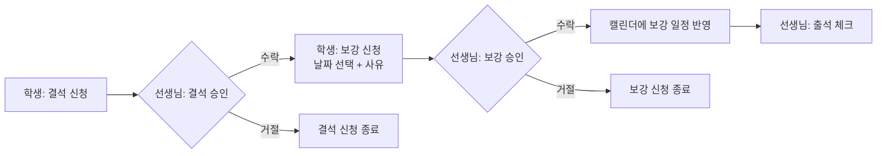

  

<h1 align="center">Refit Server</h1>
 

  <b>학원 수업의 결석부터 보강까지, 한 곳에서 관리하는 서비스</b>

> Refit Server는 학생과 선생님이 수업·출결·결석·보강 일정을 함께 관리할 수 있도록 돕는 Spring Boot API 서버입니다.
> 학생은 결석과 보강을 신청하고, 선생님은 이를 승인하며 출석을 체크합니다. 모든 일정은 캘린더 하나에서 확인할 수 있습니다.

## 서비스 소개

### 문제 정의

학원이나 소규모 수업에서는 결석이 생기면 보강 일정을 메신저나 직접 만나서 조율하는 경우가 많습니다.
이 과정에서 선생님은 학생별 결석·보강 현황을 한눈에 파악하기 어렵고, 학생은 자신의 보강이 확정되었는지 확인하기 번거롭습니다.

### Refit이 해결하는 것

- **학생**: 수업 고유코드로 간편하게 참여하고, 결석 신청 → 보강 신청까지 앱 안에서 끝냅니다.
- **선생님**: 수업을 만들고, 결석·보강 요청을 승인하며, 보강 가능 시간과 학생별 시간표를 관리합니다.
- **모두**: 수업일, 보강일, 결석일, 보강 대기 중인 날짜를 캘린더에서 한눈에 확인합니다.

### 서비스 흐름

##  기술 스택
 
### Frontend (Web)
 
| 분류 | 기술 |
| --- | --- |
| Language | HTML, CSS, JavaScript |
| Library | React |
| Build Tool | Vite |
 
### Mobile App
 
| 분류 | 기술 |
| --- | --- |
| Framework | React Native |
 
### Backend (이 저장소)
 
| 분류 | 기술 |
| --- | --- |
| Language | Java 21 |
| Framework | Spring Boot 4.1.1 |
| Web | Spring MVC, Spring Validation |
| Auth | Spring Security, JWT (JJWT 0.12.6) |
| Persistence | Spring Data JPA, MySQL |
| Cache | Redis (Spring Data Redis) |
| Mail | Spring Mail (SMTP) — 이메일 인증코드 발송 |
| Build | Gradle |
| Etc | Lombok |
