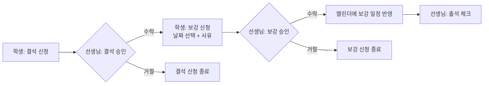

  

<h1 align="center">Refit Server</h1>
 

  <b>학원 수업의 결석부터 보강까지, 한 곳에서 관리하는 서비스 — Refit</b>

> Refit Server는 학생과 선생님이 수업·출결·결석·보강 일정을 함께 관리할 수 있도록 돕는 Spring Boot API 서버입니다.
> 학생은 결석과 보강을 신청하고, 선생님은 이를 승인하며 출석을 체크합니다. 모든 일정은 캘린더 하나에서 확인할 수 있습니다.

## 서비스 소개

### 문제 정의

학원이나 소규모 수업에서는 결석이 생기면 보강 일정을 메신저나 직접 만나서 조율하는 경우가 많습니다.
이 과정에서 선생님은 학생별 결석·보강 현황을 한눈에 파악하기 어렵고, 학생은 자신의 보강이 확정되었는지 확인하기 번거롭습니다.

### Refit이 해결하는 것

- **학생**: 수업 고유코드로 간편하게 참여하고, 결석 신청 → 보강 신청까지 앱 안에서 끝냅니다.
- **선생님**: 수업을 만들고, 결석·보강 요청을 승인하며, 보강 가능 시간과 학생별 시간표를 관리합니다.
- **모두**: 수업일, 보강일, 결석일, 보강 대기 중인 날짜를 캘린더에서 한눈에 확인합니다.

### 서비스 흐름

> 선생님은 보강 가능 날짜(날짜·시작 시간·종료 시간)를 미리 등록해 둘 수 있습니다.

---

## 주요 기능

### 공통

| 영역 | 기능 |
| --- | --- |
| 회원가입 / 로그인 | 구글 계정 또는 이메일 인증코드로 가입·로그인, 가입 후 역할(학생/선생님) 선택 |
| 프로필 | 프로필 조회·등록·수정, 사용자 이름·이메일 확인 |
| 회원 탈퇴 | 이메일 인증코드와 `계정 삭제` 입력으로 계정 삭제 |
| 알림 | 수신한 알림 확인, 모두 읽음 처리 |

### 학생

| 영역 | 기능 |
| --- | --- |
| 수업 | 고유코드로 수업 참여, 참여 중인 수업 목록 조회, 수업 나가기 |
| 수업 홈 | 캘린더로 수업·보강·결석·보강 대기 일정 확인, 이번 달 출석/결석 일수 확인 |
| 결석 | 결석 신청, 신청 취소(미승인 건), 신청·승인된 결석 날짜 조회 |
| 보강 | 보강 신청(날짜 선택, 사유 입력), 신청 취소(미승인 건), 신청·승인된 보강 날짜 조회 |
| 공지 | 선생님이 작성한 공지 목록 및 상세 조회 |

### 선생님

| 영역 | 기능 |
| --- | --- |
| 수업 | 수업 생성(제목 필수, 배너 사진 선택), 수업 목록 조회, 수업 나가기 |
| 수업 홈 | 캘린더로 수업 일정 확인, 이번 달 학생들의 총 출석·결석·보강 일수 확인 |
| 학생 관리 | 학생별 정보(이름, 보강/총결석, 최근 결석, 보강 여부, 보강 필요 일수) 조회 |
| 출석 | 학생 출석 상태 확인, 출석/결석 설정 및 변경 |
| 결석 | 학생별 결석 정보(결석 날짜, 사유, 승인 상태) 조회, 수락/거절 설정 및 수정 |
| 보강 | 학생별 보강 정보(보강 날짜, 시간, 승인 상태) 조회, 수락/거절 설정 및 수정 |
| 보강 가능 시간 | 보강 가능 날짜·시간 추가, 수정, 삭제 |
| 스케줄 관리 | 학생별 수업 시간표(요일) 조회·등록·수정·삭제, 요일별로 출석 학생 조회 |
| 공지 | 공지 작성·조회·수정·삭제 |

---

## 기술 스택

| 분류 | 기술 |
| --- | --- |
| Language | Java 21 |
| Framework | Spring Boot 4.1.1 |
| Web | Spring MVC, Spring Validation |
| Auth | Spring Security, JWT (JJWT 0.12.6) |
| Persistence | Spring Data JPA, MySQL |
| Cache | Redis (Spring Data Redis) |
| Mail | Spring Mail (SMTP) — 이메일 인증코드 발송 |
| Build | Gradle |
| Etc | Lombok |
